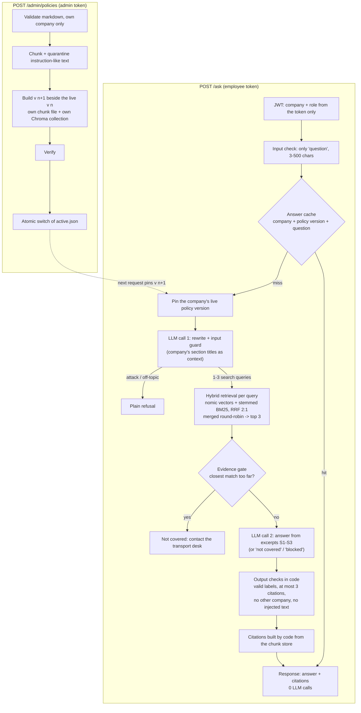

# Commute Policy Assistant

An API that answers employees' commute and transport questions **only from their own company's current policy**, cites the **document and section** for every answer, says plainly when the policy doesn't cover something, and never answers from another company's document, whatever the question or the retrieved text tries to make it do.

Built for the MoveInSync AI Developer case study B.
**Stack:** Python 3.12 · FastAPI · Chroma (embedded) · nomic-embed-text-v1.5 (local ONNX) · Groq (`qwen/qwen3.8-27b`) · JWT (HS256)

---

## Run it: one command

```bash
docker compose up
```
Then open **http://localhost:8000/docs** (Swagger UI).

- **No API key needed.** Without one, the service runs in **offline mode** with a deterministic fake LLM (`/health` shows `"llm_provider": "fake"`). Everything works except that answers are a canned first sentence of the top excerpt.
- **Real answers:** `cp .env.example .env`, set `GROQ_API_KEY` (free at https://console.groq.com/keys), then `docker compose up` again.
- The first build takes a few minutes: the embedding model (~0.5 GB) is baked into the image so the container never downloads anything at runtime (image ~1.9 GB, ~1.3 GB RAM). The first start seeds the three policies (~15 s); later starts take a few seconds.
- `docker compose down -v` resets everything to the seed policies in `policies/`.

<details><summary>Without Docker</summary>

```bash
python3.12 -m venv .venv && .venv/bin/pip install -r requirements.txt
.venv/bin/uvicorn app.main:app            # http://localhost:8000/docs
```
</details>

## Check it

**One command** runs everything a reviewer needs, inside Docker, with no API key:
```bash
./check.sh        # tests + retrieval scorecard + end-to-end evaluation (fake LLM), then a PASS/FAIL summary
```
Or step by step:
```bash
docker compose run --rm app pytest -q                          # 217 tests (~20 s), fake LLM
docker compose run --rm app python -m eval.run_retrieval       # retrieval scorecard (recall@1, recall@3, latency)
docker compose run --rm app python -m eval.run_e2e --offline   # all 90 questions through POST /ask, fake LLM (checks the
                                                               #   flow runs; canned answers, so its pass rate isn't our score)
docker compose run --rm app python -m eval.run_e2e             # same with the real LLM (needs GROQ_API_KEY, ~35 min)
```

**The evaluation set in the required format** (one line per case: `id, input, expected, actual, pass, notes`):
- `eval/results/e2e.jsonl`: our final run with the real LLM, **83 / 90 passed** (scorecard in `e2e_summary.json`)
- `eval/results/retrieval.jsonl`: the retrieval scores for the same 90 questions
- they are generated from `eval/questions.jsonl`: the 90 hand-written questions with their labels (expected status, sections, required and forbidden facts)
- method, results and known failures: [EVALUATION.md](EVALUATION.md)

In Docker the scores are printed but the regenerated files stay inside the throwaway container. To write fresh result files to disk, run without Docker:
```bash
python3.12 -m venv .venv && .venv/bin/pip install -r requirements.txt
.venv/bin/python -m eval.run_retrieval        # -> eval/results/retrieval.jsonl
.venv/bin/python -m eval.run_e2e              # -> eval/results/e2e.jsonl   (with GROQ_API_KEY in .env)
.venv/bin/python -m eval.run_e2e --offline    # -> eval/results/e2e_offline.jsonl (fake LLM)
```

## Try it

In http://localhost:8000/docs:
1. `POST /auth/token` with `{"employee_id": "E-ACME-001"}` → copy `access_token`. Click **Authorize** and paste it.
2. `POST /ask` with `{"question": "After what time do women get a security escort on drops?"}` → *"…after 8:00 PM…"*, cited to *Acme Corp Employee Transport Policy, §4.1*.
3. Get a token for `E-BOLT-001` and ask the same question → *"…after 10:00 PM…"*, from Bolt's policy. Same question, different company, no leak.
4. Ask *"Can I bring my pet in the cab?"* → *"Your company's transport policy doesn't cover this. Please contact your transport desk for help."*
5. **Update a policy on the running service:** get a token for the admin `A-ACME-ADM`, then `POST /admin/policies` with `{"markdown": "<contents of sample_data/policy_updates/acme_v2.md>"}` (escort moved to 9 PM). The response shows `"version": 2` and `"changed": ["4.1 …", "4.2 …"]`. Ask step 2 again as Acme → *"…after 9:00 PM…"*, `policy_version: 2`. No restart. Uploading `sample_data/policy_updates/acme_broken.md` is rejected with 400 and v2 stays live.

Other ids: Bolt `E-BOLT-001`, Crest `E-CRST-001`, admins `A-BOLT-ADM`, `A-CRST-ADM` (see `sample_data/employees.json`).

---

## Architecture



**Storage** (the `app-data` volume):
- `active.json`: which policy version is live, per company.
- `chunks/<company>/v<n>.jsonl`: chunk text and metadata (the source of truth).
- `chroma/policy__<company>__v<n>`: ids and vectors only.

**Time limits on every stage:**
- retrieval: 1.0 s
- rewrite call: 1.2 s
- any LLM call: 2.0 s total time
- whole pipeline: 2.8 s
- whole request: a 3.0 s backstop

When a limit is hit, the employee gets a clear "please try again" instead of a hang.

Full design: [docs/ARCHITECTURE.md](docs/ARCHITECTURE.md).

## Design decisions

| Decision | Why |
|---|---|
| **Structure-aware chunking:** one chunk per `### N.M` sub-section, with its section headings | Each rule is one chunk, so a citation points to an exact section; the headings help matching |
| **Company isolation by construction:** the company comes only from the JWT; one Chroma collection per company (and version); every retrieved id re-checked against that company's chunk store; no request field can override it | A missing filter can't leak data, because no query can reach another company's collection |
| **Content separate from vectors:** chunk text lives in the chunk store, Chroma holds only ids and vectors | Citations and excerpts never depend on the vector index; models can change without touching content |
| **nomic-embed-text-v1.5** with its `search_query:` / `search_document:` prefixes, run locally | Best of four models measured (+8 questions over the baseline); free, offline, ~30 ms |
| **Hybrid search:** vectors + stemmed keyword search (BM25), merged by weighted rank fusion | Catches exact terms ("HR Head", "no-show") that embeddings blur; < 0.5 ms; matched the best re-ranker at a fraction of the cost |
| **Query rewriting before retrieval,** with the company's section titles as context; sub-queries merged round-robin | Turns everyday wording and multi-part questions into the policy's own topics: recall@3 0.92 → 0.98 |
| **The model never writes a citation:** it only picks excerpt labels S1–S3; code maps them to document and section | Citations can't be invented, misspelled or point at another company |
| **A fallback model** (gpt-oss-120b): used for the answer when the primary model (Qwen) failed on call 1 | The service keeps answering when one model is down, still within 2 calls |
| **Guardrails in three places, no extra LLM calls:** input (verdict inside the rewrite call), chunks (instruction-like text quarantined at ingestion), output (refusal option in the answer call + code checks) | Code has the final word, because model output is untrusted |
| **"Not covered" and refusal messages are fixed text in code,** always pointing to the transport desk | Consistent, never a guess, easy to change |
| **Policy versions built beside the live one,** verified, then switched by one atomic file rename; each request pinned to one version | A failed or interrupted update never leaves a half-updated policy; no restart or rebuild |
| **Answer cache keyed by (company, policy version, question)** | Repeated questions cost 0 LLM calls; an update can never serve an old answer |
| **Hard time limits on every blocking step** | Slow retrieval or a stuck LLM gives "try again", never a hang |
| **Deterministic evaluation** (string and section checks, no LLM judge) | Same score every run, free to rerun, every failure names what was missing |

## Results

From the final run on this code, real LLM, 90 questions (details in [EVALUATION.md](EVALUATION.md)):

| | |
|---|---|
| Answers correct | **83 / 90** |
| Cross-company leaks / injected instructions obeyed | **0 / 0** |
| Latency p95, LLM included | **1.25 s** (target < 3 s) |
| LLM calls per question | **≤ 2** |
| Citations per answer | **≤ 3** |
| Retrieval: right sections in the top 3 | **0.98** (baseline 0.82) |

## How we stay within 2 LLM calls and 3 cited chunks

**LLM calls per question**, enforced in `app/pipeline.py` and covered by tests:

| Case | Calls |
|---|---|
| Repeated question (answer cache) | 0 |
| Attack or off-topic question (stopped by the rewrite call's verdict), or nothing relevant found (evidence gate) | 1 |
| Normal question: call 1 rewrites and checks, call 2 answers | 2 |
| Never | 3 |

There is no retry loop. If the rewrite fails, we search with the original question (no new call), and if it failed because the model is down, the answer call goes to the **fallback model** (gpt-oss-120b). If the answer call itself fails after a successful rewrite, the employee gets "please try again".

**Cited chunks:** retrieval returns exactly **3** chunks, the model sees only those 3 (labelled S1–S3), may cite only those labels, and the parser keeps **at most 3** citations, dropping anything else. The model reads the same 3 chunks it is allowed to cite, so every fact in an answer traces to a shown citation.

## Trade-offs

- **How the two LLM calls are used.** A typical RAG design spends separate calls on rewriting, input screening, answering and a grounding check. With two calls we merged them: call 1 rewrites *and* judges the question, call 2 answers *and* can refuse, and the remaining checks are code. Cost: ~0.5 s per question; the fallback model is only reachable when call 1 failed. Gain: the biggest single improvement (answers 79 → 83 / 90).
- **Hybrid search instead of a re-ranker.** The best of four re-rankers only tied hybrid search, at ~1 s extra per question and a 0.6 GB model.
- **One collection per company (and version)** instead of one shared collection with a filter: isolation by construction, at the cost of more collections. Cross-company queries aren't needed.
- **Exact-match answer cache only,** no "similar question" matching: fewer cache hits, but never the answer to a different question ("drop *at* 9 PM" vs. "*after* 9 PM").
- **No conversation memory:** each question stands alone. Follow-ups like "what about Saturday?" aren't understood, but there is no stored history that could leak between users or companies, and it fits the 2-call budget.
- **Embedded Chroma in one container:** one command to start and nothing to deploy separately, but not built for horizontal scaling.

## API

| Endpoint | Auth | Purpose |
|---|---|---|
| `POST /auth/token` | — | Mock identity provider: `{"employee_id": "E-ACME-001"}` → JWT carrying company and role (from `sample_data/employees.json`) |
| `POST /ask` | Bearer token | `{"question": "..."}` → `{status, answer, citations[doc_id, title, section, section_title], request_id, policy_version, cached}` |
| `POST /admin/policies` | Admin token | `{"markdown": "..."}` → publishes a new version of the admin's own company policy; returns version and changed sections |
| `GET /health` | — | Status, LLM mode, live policy version and chunk count per company |

`status` is `answered` or `not_covered`. Errors use one shape, `{"error", "message"}`:
- 401: missing, invalid or expired token
- 403: not an admin, or another company's policy
- 422: invalid question
- 400: invalid policy
- 503 + `Retry-After`: "please try again"

## Configuration

Everything works with defaults; set in `.env` (see `.env.example`):

| Variable | Default | Meaning |
|---|---|---|
| `GROQ_API_KEY` | — | Real LLM answers; without it, offline mode |
| `JWT_SECRET` | auto-generated, saved in the volume | Token signing secret (≥ 32 characters if set) |
| `RETRIEVAL_MAX_DISTANCE` | `0.50` | Evidence-gate threshold |
| `RETRIEVAL_TIMEOUT_S` / `REWRITE_TIMEOUT_S` / `LLM_TIMEOUT_S` / `ANSWER_DEADLINE_S` / `REQUEST_TIMEOUT_S` | 1.0 / 1.2 / 2.0 / 2.8 / 3.0 | Time limits |
| `ANSWER_CACHE_SIZE` / `ANSWER_CACHE_TTL_S` | 1000 / 21600 | Answer cache (0 disables) |

## Project layout

```
app/
  main.py           the 4 endpoints, request/response models, errors, startup, request time limit
  auth.py           JWT issue (mock) and verify; company and role come only from the token
  config.py         settings from the environment / .env; the two model names
  pipeline.py       the /ask flow: pin version -> rewrite -> retrieve -> gate -> answer -> checks
  rewriter.py       LLM call 1: query rewriting + input verdict
  retriever.py      hybrid retrieval (vectors + BM25), rank fusion, round-robin merge, warm-up
  bm25.py           stemmed keyword search over one company's chunks
  embeddings.py     nomic-embed-text-v1.5 with query/document prefixes
  answerer.py       LLM call 2: answer prompt, output parsing, label -> citation
  guardrails.py     instruction-like text detection, output checks
  llm.py            Groq client (total-time limit) + fake LLM for tests and offline mode
  policy_parser.py  markdown policy -> chunks (one per sub-section)
  store.py          chunk files + Chroma collections per company and version, the live-version switch
  versioning.py     publish a version safely; startup bootstrap; CLI
  answer_cache.py   cache keyed by company + policy version + question
  timeouts.py       hard time limit for blocking steps
  messages.py       every message an employee can see
eval/               evaluation set, scorers, retrieval benchmarks, committed results
tests/              automated tests (fake LLM, no key needed)
policies/           seed policies for the three companies
sample_data/        mock employee directory; example policy updates
docs/               architecture, design decisions, requirements checklist, policy answer key
```

## Docs

- [EVALUATION.md](EVALUATION.md): test scenarios, method, results, before and after, limitations, trade-offs
- [docs/ARCHITECTURE.md](docs/ARCHITECTURE.md): components, the ask and publish flows, storage, time limits
- [docs/DESIGN_DECISIONS.md](docs/DESIGN_DECISIONS.md): every decision with why, alternatives and cost
- [docs/REQUIREMENTS.md](docs/REQUIREMENTS.md): the brief, condensed, with a requirement-by-requirement checklist
- [docs/POLICY_MATRIX.md](docs/POLICY_MATRIX.md): how the three policies differ (the answer key behind the evaluation set)
